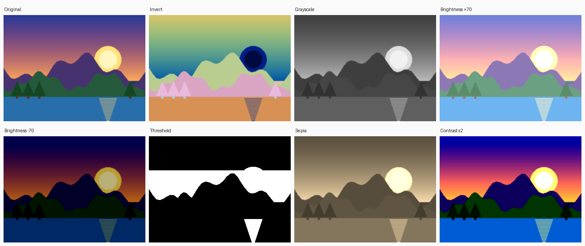

# Real-Time Image Processing Pipeline (Verilog)

A streaming RGB pixel-processing pipeline in Verilog with 8 operations: invert, grayscale, brightness up/down, threshold, sepia, contrast and pass-through. The testbench reads a real `.bmp` image using pure Verilog file I/O, streams it through the hardware one pixel per clock, writes the result back out as a `.bmp`, and checks every pixel against a reference model.



## Architecture

```
            mode, param
                 │
 pixel in ──►┌───▼─────────────────────┐   ┌──────────────────────────┐
 (R,G,B,     │ Stage 1                 │   │ Stage 2                  │──► pixel out
  valid)     │  register pixel         │──►│  select operation (mode) │    (R,G,B,
             │  gray  = 77R+150G+29B   │   │  saturate / clamp to 255 │     valid)
             │  sepia = 3 weighted sums│   │                          │
             └─────────────────────────┘   └──────────────────────────┘
                     throughput: 1 pixel / clock      latency: 2 clocks
```

| Mode | Operation | `param` |
|------|-----------|---------|
| 0 | Pass-through | – |
| 1 | Invert (negative) | – |
| 2 | Grayscale | – |
| 3 | Brightness up (saturating) | amount |
| 4 | Brightness down (saturating) | amount |
| 5 | Threshold (black & white) | level |
| 6 | Sepia | – |
| 7 | Contrast × 2 | – |

## Key design ideas

- **Streaming, pipelined:** one pixel enters and one leaves every clock. A 320×240 image (76,800 pixels) takes 76,802 cycles, about 0.77 ms at 100 MHz, which is fast enough for real-time video.
- **Fixed-point maths, no floating point or division:** grayscale weights 0.299 / 0.587 / 0.114 become 77 / 150 / 29 out of 256, so the divide is just a shift (`>> 8`).
- **Saturating arithmetic:** brightness and contrast clamp at 0 and 255 instead of wrapping around (otherwise bright pixels would turn dark).
- **Two pipeline stages:** multiplications in stage 1, selection and clamping in stage 2, which keeps the critical path short for a higher clock speed.

## Verification

The testbench (`tb/tb_image_proc.v`) is plain Verilog:
- Reads the BMP header and pixel data with `$fopen` / `$fgetc` (24-bit and 32-bit BMP, row padding handled)
- Streams pixels into the DUT one per clock with a valid signal
- Compares **every output pixel** with an independent reference function in the testbench
- Writes one output image per mode with `$fwrite`

```
  PASS  mode 1 invert           76800 pixels in 76802 cycles
  PASS  mode 2 grayscale        76800 pixels in 76802 cycles
  PASS  mode 6 sepia            76800 pixels in 76802 cycles
  ...
  ALL TESTS PASSED (8 modes, every pixel checked)
```

Pass-through output is byte-identical to the input file, confirming the BMP read/write path. A deliberately injected coefficient bug was caught (40,000+ mismatching pixels).

## How to run (macOS / Linux)

```bash
make                              # process images/input.bmp in all 8 modes
make IMAGE=images/my_photo.bmp    # use your own picture
make synth                        # Yosys resource report (optional)
make clean
```

Results appear in `output/`. Open them in Preview on a Mac.

**Using your own photo on a Mac:** convert it to BMP with the built-in `sips` tool, resizing it so the simulation stays quick:
```bash
sips -s format bmp -Z 400 photo.jpg --out images/my_photo.bmp
```

## Possible extensions

- 3×3 convolution with line buffers (blur, sharpen, Sobel edge detection)
- Histogram calculation
- RGB to YCbCr colour-space conversion
